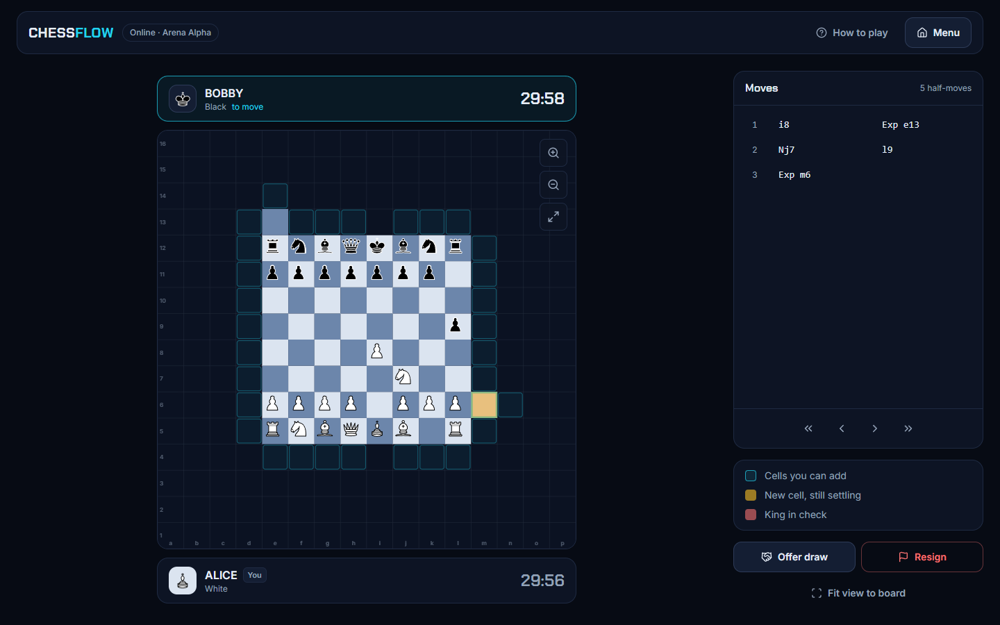

# ChessFlow

**Chess on a board that grows.** ChessFlow keeps the full chess army and the chess rules you already know, but puts them on a 16×16 grid where only the central 8×8 is playable at the start. On every turn you choose: **move a piece, or add one new cell to the edge of the board.** Space becomes a resource you build, not just a resource you fight over.



> Current version: **v3.0** (2026-10-24). Full rules, architecture and design reasoning are in [PROJECT.md](PROJECT.md). Bot-vs-bot balance results are in the [balance report](docs/balance-report.md).

---

## What makes it different

| Classical chess | ChessFlow |
|---|---|
| Fixed 8×8 board | 16×16 grid, starts as the central 8×8 and grows one cell at a time |
| Every turn is a move | Every turn is a move **or** an expansion |
| Board edges are permanent | Edges move: new files and ranks open lines for rooks, bishops and queens |
| Promotion on the 8th rank | Promotion on the **farthest active cell of the column**, so expanding a column pushes its promotion line back |

## Rules at a glance

1. **Pieces and moves are standard chess** (check, checkmate, stalemate, castling, promotion). En passant is not used.
2. **Your turn = one action:** move a piece **or** activate one inactive cell.
3. **Expansion rules:**
   - the new cell must touch the current board orthogonally (side, not corner), so the board is always one connected shape;
   - it cannot be next to either king (*king buffer*);
   - you cannot expand while you are in check, so a check must always be answered with a move;
   - the new cell is **stabilizing** (shown in orange) until your next turn starts. Your opponent cannot move onto it or through it in the meantime, but your own pieces' attacks through it already count.
4. **Inactive cells are holes.** Sliding pieces stop at them, pawns cannot step onto them, and knights jump over them but must land on an active cell.
5. **Game end:** checkmate, resignation (*Resign*, two clicks), or running out of time win the game. Draws come from **agreement** (*Offer Draw*; the opponent accepts or declines, and making a move also declines) or **stalemate**, which needs *no legal move and no legal expansion*. If you can still expand, you must.
6. **Clock:** 30 minutes per player. It starts only once both players are seated, named, and have clicked **I'm ready** (after the How-to-Play guide), and pauses if a player disconnects.

### Reading the move list
Moves use the full grid: **files `a`–`p`** (left to right from White's side) and **ranks `1`–`16`** (bottom to top). The starting 8×8 board covers **e5–l12**. Coordinates are drawn along the bottom and left edges of the board.

| Notation | Meaning |
|---|---|
| `i8` | pawn to i8 (the classical e2–e4) |
| `Nj7` | knight to j7 (`x` marks a capture: `Bxj11`) |
| `Rfi8` / `R6e8` | origin file / rank added when two identical pieces could reach the cell |
| `O-O`, `O-O-O` | castling |
| `e12=Q` | promotion |
| `Exp d8` | expansion: cell d8 activated |
| `+` / `#` | check / checkmate |

## Features

- **Interactive How-to-Play guide:** 8 short steps, each with a mini board you can play on. The real rules run the demos: expand a cell, try to use an orange cell, answer a check, jump a gap with a knight, promote on a longer column. It opens automatically before your first game on a browser; after that you just confirm **I'm ready**. You can reopen it from the menu or with *How to play* during a game.
- **Play vs Computer:** Easy, Medium or Hard. Choose White, Black or random, play timed (10 or 30 min) or untimed, and use **undo** to take back a move. The computer thinks in a background thread, so the page never freezes. It runs entirely in your browser (no server, no account), and the game is saved there, so you can resume it after a reload.
- **Expanding board** with live highlights for legal moves, expansion cells, stabilizing cells, the last move and a king in check.
- **Online multiplayer** in two rooms protected by server-checked passcodes (*Arena Alpha*, *Arena Beta*): 2 players each, so 4 players at once, plus any number of **spectators**.
- **Chess clocks** (30 min each), with the server as the source of truth.
- **Move list:** a paired White/Black move list. Click any move, or use ⏮ ◀ ▶ ⏭, to replay the game from the starting position.
- **Free / locked view:** pan and zoom the whole grid, or lock the camera to frame the active board (works from both White's and Black's side).
- **Offer Draw** (one offer per move; the opponent gets Accept / Decline) and **Resign** with a confirmation click. A result screen gives the reason, with *Review board* and *New game* for the same two players.
- Responsive layout for phones, laptops (1366×768 included) and large monitors.

## Getting started (local)

Requirements: **Node.js 20.9+** (tested on Node 24) and npm.

```bash
npm install        # install dependencies
npm run dev        # dev server on http://localhost:3000 (also reachable on your LAN)
```

The site opens on a menu: **Play online** (two players, see below) or **Play vs computer** (pick a difficulty, your color and the clock, then *Start game*; nothing else to set up).

Then follow [Start a test game with 2 players](#start-a-test-game-with-2-players) below.

### Start a test game with 2 players

There is no "create room" step. **Two rooms are hard-coded and always open**, so you just pick one:

| Room | Default passcode (not case-sensitive) | Direct link (opens that room's passcode screen) |
|---|---|---|
| Arena Alpha | `ARCHON` | `http://localhost:3000/?room=ALPHA` |
| Arena Beta | `PHANTOM` | `http://localhost:3000/?room=BETA` |

Each room seats 2 players, so up to **4 people can play at the same time** (2 in Alpha, 2 in Beta). Anyone else who joins a full room watches as a **spectator**.

The passcodes are checked **by the server** and never sent to the browser. They are set in [src/server/config.ts](src/server/config.ts), and on a real deployment you can change them without touching the code by using environment variables:
```bash
CHESSFLOW_PASSCODE_ALPHA=mysecret CHESSFLOW_PASSCODE_BETA=another npm start
```
After you have joined once, reloading the page puts you straight back in your seat without asking for the passcode again.

**Steps**
1. Start the server: `npm run dev`.
2. **Player 1 (White):** open `http://localhost:3000`, click **Play online**, then **Arena Alpha**, type `ARCHON` and click **Join room**. You will see *Waiting for an opponent*.
3. **Player 2 (Black):** open the same address in a **different browser, or in a private/incognito window**, and join Arena Alpha the same way.
   > Two normal tabs of the *same* browser share one session, so they count as the *same* player. Use two different browsers (e.g. Chrome + Edge), a normal and a private window, or two devices.
4. Both players type a callsign (2–16 characters) and press **Enter**.
5. The **How-to-Play guide** opens for each player (the first time on that browser; after that a short *Ready?* card). Read through it or click *Skip guide*, then **I'm ready**. The clocks start once both players are ready. The first one ready sees "Waiting for … to get ready".
6. **White moves first.** To move, click one of your pieces, then one of the dots. To **expand**, click one of the faint cyan cells around the board instead. One action per turn.
7. Optional: open a third window or device on the same room to watch as a spectator.

**Playing from a phone or a second laptop (same Wi-Fi):** the dev server listens on your whole network. Use the **Network** address printed by `npm run dev` (for example `http://192.168.1.20:3000`) on the other device. If Windows asks whether to allow Node.js through the firewall, allow it on private networks.

**Playing with someone outside your network:** run `ngrok http 3000 --region=ap` and send them the `https://…ngrok…` link.

**Starting over**
- **After a game ends:** click **New game** on the result screen or in the sidebar. Same players, same colors, fresh board.
- **During a game:** use **Resign** (two clicks), then start a new game. A new game can't be started while a game is still in progress.
- **Free the seats** (e.g. to swap who plays White): close every window that is in that room and wait about 15 seconds. The room resets itself, and the next person to join becomes White. Restarting the server also clears all rooms.
- **Forgotten rooms close themselves:** a room with no join, move or other action for **3 hours** is closed automatically, even if a tab is still open. Anyone still on the page is sent back to the room screen with a message, and can join again with the passcode.

**Troubleshooting**
- *"Both seats are taken" (or a "Watching" badge) when you expected to play:* the room already has two seated players, often an old window that is still open. Close it, wait 15 seconds, then rejoin, or use the other room.
- *Both windows stay on "Waiting for an opponent":* both windows are in the same browser session, so the server sees one player. See the note in step 3.

### All scripts

| Command | What it does |
|---|---|
| `npm run dev` | Development server with hot reload |
| `npm run build` | Production build |
| `npm start` | Run the production build (`next start`, port 3000 by default) |
| `npm run lint` | ESLint |
| `npm test` | Run the unit test suites once (Vitest) |
| `npm run test:watch` | Re-run unit tests on every file change |
| `npm run test:e2e` | Build, start the app, and run the browser tests in your installed Edge or Chrome |
| `npm run simulate` | Play 500 bot-vs-bot games in parallel and regenerate the [balance report](docs/balance-report.md) (~8 min; `--self N --compare M --shards K`; `--report-only` rebuilds the report from saved data) |

## Testing

### Unit tests (`npm test`)
The rules engine in `src/game/` and the room logic in `src/server/` are plain TypeScript with no React or network code, so they are tested directly with **Vitest**: **163 tests in 15 files**, all passing.

| File | Covers |
|---|---|
| `setup.test.ts` | Starting position, 20 opening moves, 30 opening expansion cells |
| `movement.test.ts` | Every piece on a dynamic board: holes, edges, knights jumping the void |
| `check.test.ts` | Pins, answering check, pawn attacks, castling (all conditions), checkmate, stalemate, "must expand" |
| `expansion.test.ts` | Boundary rule, king buffer, stabilization, discovered check through a new cell, connectivity |
| `promotion.test.ts` | Farthest-cell rule, expansion pushing the line back, destination-column rule, all four pieces |
| `reducer.test.ts` | Illegal actions change nothing, names, resign, half-move counter, replay of past positions |
| `notation.test.ts` | Grid labels, captures, check, disambiguation |
| `clock.test.ts` | Whole-second charging, sub-second carry-over, pausing, timeout |
| `viewbox.test.ts` | Locked view frames every active cell for both colors |
| `invariants.test.ts` | Six seeded random games: kings never captured, board stays connected, replay reproduces the game |
| `draw.test.ts` | Offer, accept, decline, "playing on declines", one offer per move, nothing after the game ends |
| `guide.test.ts` | Every guide step is a legal position whose task can be completed; orange cell really blocked; check step offers no expansion; promotion step |
| `ai/equivalence.test.ts` | The computer's fast engine lists **exactly** the same legal actions and check verdicts as the rules engine, on every position of 8 random games and on edge cases; make/unmake and hashing are exact |
| `ai/bot.test.ts` | Legal moves at every level, finds mate in one, takes a hanging queen, keeps its own queen safe, answers checks, expands when forced, respects its time limit, accepts draws only when worse, speed benchmark |
| `server/roomStore.test.ts` | Passcodes, seats, rejoining, who may do what (turn, spectators, forged requests, draw offers), new-game rules, the 3-hour rule, presence and clock pausing |

### Browser tests (`npm run test:e2e`)
The [e2e/](e2e/) scripts build the app, start it, and drive real browser windows (your installed **Microsoft Edge or Google Chrome**; nothing extra is downloaded). **132 checks**, all passing:

| Suite | Covers |
|---|---|
| `security.mjs` | Hand-crafted API requests: no passcodes anywhere in the page or its JavaScript, API answers never cached, wrong/missing passcode, out-of-turn moves, spectators, strangers, forged player fields, the removed "push a whole state" request, illegal moves |
| `online.mjs` | Two players and a spectator: passcode screen, lobby, direct link, names, reload rejoin, **guide and ready gate** (guide for both, mini board playable, arrow keys, waiting card, clock and server wait for both), moves, expansion and stabilization, check, playback, Black's locked view, resign, result screen, new game, draw offer (decline, limit, accept); own move shows in under 100 ms |
| `layout.mjs` | 1920×1080, 1366×768 and 390×844 (plus 1440×900 in `online.mjs`): board inside its frame, no sideways scrolling, whole board column on screen |
| `computer.mjs` | Easy as White and Medium as Black: setup screen, thinking indicator, bot replies (Easy in ~0.3 s, Medium opening in ~0.45 s), **no main-thread freeze**, zero server requests, undo, draw offer declined, reload and resume, resign, new game, clocks, the 3-hour rule, phone layout |
| `expiry.mjs` | A second server with a 10-second "3 hours": the room stays open until the limit even while polling, then closes; the player is told why, can rejoin, and stays in the room afterwards |

Screenshots of each run are saved in `e2e/screenshots/` (not committed). To run only some suites against an existing build: `node e2e/run.mjs security online`.

## Balance report

[docs/balance-report.md](docs/balance-report.md) contains **500 computer-vs-computer games** played with the game's own bot, all reproducible from their seeds:
- **Colors are balanced:** White scored **49.8 %** in 300 self-play games (95 % confidence interval 45.2–54.5 %).
- **Expansion is used throughout:** 89 % of games had expansions, about 25 cells were added per game, mostly in the middlegame and late game, and the board grew from 64 to about 97 cells.
- **Expansion is a real decision, not a free bonus:** an expansion-aware bot scored **44.8 %** (CI 39.0–50.5 %) against an identical bot that never expands. Spending a move on the board has to be worth it, and the bot's expansion judgement is its weakest point.

The report includes the method, the charts and every number behind them.

## Deployment (Hostinger / DigitalOcean)

ChessFlow needs **a running Node.js server**, not just static file hosting. The game state lives in the Next.js API route [src/app/api/game/route.ts](src/app/api/game/route.ts), in the server's memory, and that route handles `POST` requests. Static hosting (`output: 'export'`, plain shared HTML hosting) cannot run it.

Hosting that works:
- **DigitalOcean:** a Droplet (Ubuntu + Node.js), or App Platform as a Node.js web service with **1 instance**.
- **Hostinger:** a VPS, or a plan with Node.js app support.

Typical VPS setup:
```bash
git clone <your-repo-url> chessflow && cd chessflow
npm ci
npm run build
npm start -- -p 3000          # or keep it running with: npx pm2 start "npm start" --name chessflow
```
Put nginx (or the provider's proxy) in front of port 3000 for HTTPS.

Set your own room passcodes on the server with `CHESSFLOW_PASSCODE_ALPHA` and `CHESSFLOW_PASSCODE_BETA` (for pm2: `CHESSFLOW_PASSCODE_ALPHA=... npx pm2 start "npm start" --name chessflow`). If you don't set them, the defaults `ARCHON` / `PHANTOM` apply.

Two things to know about the in-memory design (there is no database by choice):
- **Run exactly one instance.** Several instances or serverless functions would each keep their own copy of the rooms.
- **A server restart clears every room.** Games in progress are lost. Finished games are not stored anywhere.

Earlier test deployment: [chessflow.up.railway.app](https://chessflow.up.railway.app)

## Project structure

```
docs/                         # Balance report + charts + raw results (npm run simulate)
e2e/                          # Browser tests (npm run test:e2e)
scripts/                      # simulate.mts + balance/ (bot-vs-bot games, report, SVG charts)
src/
├── app/
│   ├── page.tsx              # Room screen ↔ game, silent rejoin after a reload
│   ├── layout.tsx            # Root layout, fonts, page title
│   └── api/game/route.ts     # Thin HTTP layer over the room store
├── server/                   # Server-only code (never sent to the browser)
│   ├── roomStore.ts          # In-memory rooms: passcodes, seats, who may act, clock, 3-hour rule
│   └── config.ts             # Room names + passcodes (env-var overridable), idle limit
├── hooks/
│   ├── useOnlineGame.ts      # Polling, optimistic moves, error handling for an online room
│   ├── useComputerGame.ts    # Computer games: bot worker, undo, clock, save/resume, 3-hour rule
│   ├── useCountdown.ts       # Smooth clock display between server updates
│   └── types.ts              # GameController: what the game screen needs
├── lib/
│   ├── session.ts            # This browser's anonymous session id + saved name
│   └── computerStorage.ts    # Saved computer game + settings (localStorage)
├── components/
│   ├── ui.ts                 # Shared button / panel / dialog styles (tokens in app/globals.css)
│   ├── HomeMenu.tsx          # Start screen: Play online / Play vs computer / Resume
│   ├── ComputerSetup.tsx     # Difficulty, color and clock for a computer game
│   ├── HowToPlayGuide.tsx    # Interactive guide + "Ready?" card
│   ├── GameScreen.tsx        # Board, player tags, move list, playback, commands, overlays
│   ├── BoardSVG.tsx          # The 16×16 board: cells, highlights, coordinates, pieces, clicks
│   ├── PanZoomWrapper.tsx    # Zoom / pan container that fills the board frame
│   ├── Overlays.tsx          # Promotion, name entry, game over, lobby
│   ├── RoomSelector.tsx      # Arena + passcode screen
│   ├── PlayerTag.tsx         # Name + clock
│   └── PieceSVG.tsx          # Vector chess pieces
└── game/                     # Pure rules engine (no React, no network)
    ├── types.ts              # GameState, actions
    ├── utils.ts              # Initial position, cell helpers, view-box maths
    ├── engine.ts             # Move generation, attacks, check, expansion targets, applyMove
    ├── reducer.ts            # gameReducer(state, action) → next state (validates everything)
    ├── notation.ts           # Move-list notation
    ├── clock.ts              # Clock ticking rules
    ├── playback.ts           # Rebuild any past position from the action history
    ├── draw.ts               # When a draw may be offered
    ├── guide.ts              # How-to-Play steps: text, mini-board positions, goals
    ├── ai/                   # Computer opponent
    │   ├── position.ts       # Fast board (typed arrays, make/unmake, hashing): mirror of engine.ts
    │   ├── search.ts         # Alpha-beta search, quiescence, transposition table, move ordering
    │   ├── evaluate.ts       # Material, mobility, pawn progress, centralisation, king safety
    │   ├── bot.ts            # Difficulty levels, chooseAction, respondToDraw
    │   └── ai.worker.ts      # Runs the bot in a Web Worker
    └── __tests__/            # Vitest suites
```

## Version history

| Version | Date | Changes |
|---|---|---|
| **v3.0** | 2026-10-24 | **New look ("Neon Arena", restrained).** One design system for every screen: dark navy surfaces, a single cyan accent, status colors only where they mean something, Chakra Petch for the logo, headings and clocks, and Inter for everything else. All in tokens in `globals.css` plus shared button and panel styles.<br>• The board is steel blue, with calmer highlights (cyan for "you can act here", amber for settling cells, red for check).<br>• A slim header bar, compact player tags with a clear "to move" state, a cleaner move list, and a small board key.<br>• Plain labels (*Resign*, *New game*, *Join room*) replace the sci-fi jargon, and the blur, zoom, glow and bouncing effects are gone.<br>• Rebuilt menu, room, lobby, name, setup, guide, result and promotion screens, all keyboard-focusable with 44 px targets.<br>• **Fixed:** after a room closed, rejoining could kick you straight back out, because the browser served a cached "room closed" reply. API answers are now never cached, and a closed room screen ignores late replies. Two new browser checks (132). |
| v2.2 | 2026-10-24 | **How-to-Play guide and Ready step.** An 8-step interactive guide with live mini boards run by the real rules engine: move, expand, stabilizing cells, king buffer and check, holes and knights, moving promotion lines, then clock, draws and notation. It opens automatically for both players before their first game, or as a short *Ready?* card later. The game and clock start only when both have clicked *I'm ready*, and the server refuses moves until then. The guide can also be opened from the menu and during a game (Escape closes it). Computer games show it before your first game. Fixed a small race where the passcode screen could reopen and clear what you typed after a room closed. 16 new unit tests (163) and 18 new browser checks (130). |
| v2.1 | 2026-10-24 | **Balance report.** `npm run simulate` plays bot-vs-bot games in parallel processes and writes [docs/balance-report.md](docs/balance-report.md) with charts and raw data. 500 games: colors are balanced (White 49.8 %); expansions are used in 89 % of games (about 25 cells per game, mostly after move 10) and the board grows to about 97 cells; an expansion-aware bot does not beat a never-expanding one (44.8 %, CI 39–50.5 %), so expansion is a real trade-off and the bot's expansion judgement is the next thing to improve. |
| v2.0 | 2026-10-24 | **Computer opponent.**<br>• A new start menu (Play Online / Play vs Computer / Resume) and a setup screen: Easy, Medium or Hard; White, Black or random; untimed, 10 or 30 minutes.<br>• The bot uses its own fast copy of the rules, which tests prove matches the real rules engine exactly. It searches with alpha-beta (about 240,000 positions per second) and values material, mobility, board control, pawn progress toward each column's promotion line, centralisation and king safety. It only considers the most promising expansions, but all of them when it is forced to expand.<br>• It thinks in a Web Worker, so the page never freezes, and shows a "Thinking" indicator.<br>• Undo, draw offers (the bot accepts only when clearly worse), resign, and saving to this browser so a reload resumes the game. Games idle for 3 hours are closed.<br>• Everything happens in the browser, with no server requests. A Menu button on every game screen.<br>• 23 new unit tests (147) and 25 new browser checks (112). |
| v1.9 | 2026-10-24 | **Draw offers.** An *Offer Draw* button next to Resign. The opponent sees an Accept ½–½ / Decline banner over the board, and making a move also declines. One offer per move, so offers can't be spammed. The result shows "Game drawn by agreement (½–½)". The server makes sure you can only offer or answer for yourself. 12 new unit tests (124) and 8 new browser checks (87). |
| v1.8 | 2026-10-24 | **The server is now in charge.** Your color comes from your session: you can only move on your own turn, and only resign or rename yourself. Spectators and outsiders can't act at all, and the old "push a whole game state" request is gone. **Passcodes are checked on the server** and appear nowhere in the browser code. They can be set with environment variables, and a direct `?room=` link still asks for the code. Reloading rejoins your seat. A new game can't be forced while a game is in progress. **Rooms close after 3 hours without activity**, with a message to anyone still on the page. **Smoother:** one request per second instead of two, and clock ticks no longer redraw the board. Browser tests are now part of the repo (`npm run test:e2e`, 79 checks), plus 23 new room tests (112 unit tests). |
| v1.7 | 2026-10-24 | **Rule fixes:** expanding while in check is no longer allowed (before, it let the king be captured and the game went on without it). Stabilizing cells now really block the opponent. King buffer implemented. Stalemate only when you can neither move nor expand. Promotion is decided by the destination column. Castling now spots pawn attacks on the square the king crosses. **Gameplay:** Abandon Protocol is now a real resignation (it used to wipe the room). The result screen gives the reason and has Review Board and New Game, and a new game reaches both players (before, the second player's screen ignored the reset). **Move list:** real notation, correct White/Black pairing (name changes were being logged as moves), rejected moves no longer recorded, step-by-step playback from the starting position. **Board:** locked view frames the board correctly for Black, the board no longer overflows its frame on desktop, the whole board column fits laptop screens, coordinates a–p / 1–16, check highlight. **Clock:** no longer runs in the lobby or during name entry, and no longer gains or loses fractions of a second. Vitest suite (89 tests), ChessFlow page title, README and PROJECT.md rewritten, plus a step-by-step guide for starting a 2-player test game. |
| v1.6 | 2026-05-11 | Each turn is either a move or a single-cell expansion |
| v1.5 | 2026-04-19 | Rolled back to basic one-cell expansion options; README update |
| v1.4 | 2026-04-18 | Mobile UI fixes; chess clocks added |
| v1.3 | 2026-04-15 | Two rooms (4 players at once); spectator mode; removed duplicate board |
| v1.2 | 2026-04-14 | Move history and playback; hosting build fixes |
| v1.1 | 2026-04-13 | Name screen; layout fixes; stable two-player play |
| v1.0 | 2026-04-12 | First playable build (two local tabs); implementation plan |
| v0.1 | 2026-04-11 | Repository, licence and the original v0.3 rules spec |

*Versions before v1.7 were numbered afterwards from the commit history (the app's footer already said "Protocol v1.6").*

## Pending resolutions and future changes

**Known limitations (not fixed yet)**
- **No threefold repetition or 50-move rule** (left out on purpose; draws come from agreement or stalemate). The clock is what eventually ends drawn-out games.
- **Games live in memory only** (by design: no database). A restart clears all rooms, and only one server instance can be used.
- If a seated player leaves for good while the other stays, the seat is only freed once *everyone* has left the room for 15 seconds, or when the 3-hour rule closes the room.
- Your seat is tied to an anonymous id in your browser's storage. Clearing site data, or switching browsers, means joining again as a new visitor.
- Syncing uses polling (one request per player per second), which is fine for a few rooms but not for many.
- The computer opponent looks at only the most promising few expansions in each position (all of them when forced to expand), so it can miss an unusual expansion idea. It does not use an opening book.

**Ideas for later versions**
- Smarter computer expansions: the balance report shows they are the bot's weakest skill (better heuristics, deeper search, or learning from simulated games)
- Single-screen two-player mode
- Export/import of game records using the notation above
- Rooms created on demand with shareable codes; WebSocket / Server-Sent Events instead of polling
- Choice of time control (e.g. 10+5)

## Tech stack

Next.js 16 (App Router) · React 19 · TypeScript · Tailwind CSS 4 · Framer Motion · react-zoom-pan-pinch · Lucide icons · Vitest · Playwright (browser tests)

## License

MIT, see [LICENSE](LICENSE).
