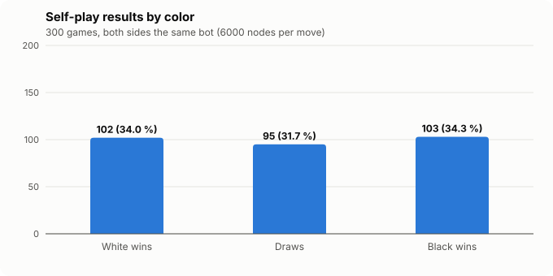
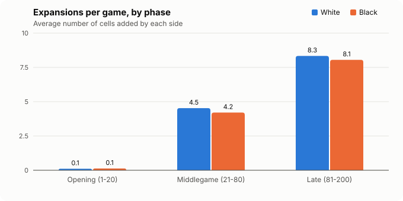
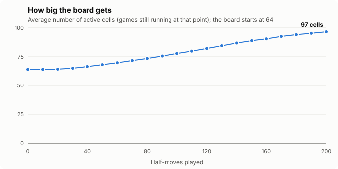
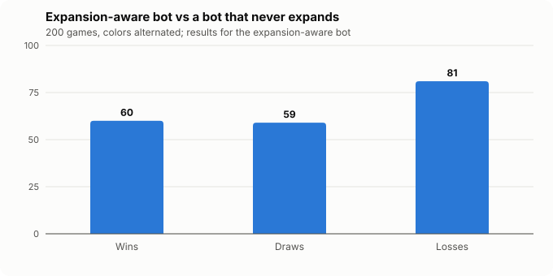

# ChessFlow balance report

*Generated by `npm run simulate` from the code in this repository (v2.1). Raw data: [balance/results.json](balance/results.json).*

## Summary

- **Color balance:** over 300 self-play games White scored **49.8 %** (95 % CI 45.2 % - 54.5 %). No significant color advantage was detected.
- **Effect of expansion:** the expansion-aware bot scored **44.8 %** (95 % CI 39.0 % - 50.5 %) against an otherwise identical bot that never expands. The expansion-aware bot did slightly worse, though the difference is within the margin of error: at this search depth its expansions do not yet pay for the tempo they cost.
- **Expansion is used throughout the game:** 89.0 % of games had at least one expansion, on average **25.4 cells were added per game**, and the first expansion came at half-move 33 (median).
- **The board grows** from 64 cells to about **97 cells** by half-move 200.

## Method

| Setting | Value |
|---|---|
| Bot | The game's own computer opponent (`src/game/ai`), Medium search, fixed budget of **6000 nodes per move** (deterministic, independent of CPU speed) |
| Opening variety | the first 4 half-moves are random legal piece moves (seeded), then both sides play the search |
| Game length cap | 200 half-moves (100 moves each) |
| Adjudication | a game reaching the cap is scored as a win for a side at least 3 pawns ahead in material, otherwise a draw (standard in engine testing) |
| Score | win = 1, draw = ½, loss = 0; 95 % confidence intervals use the normal approximation |
| Reproducibility | every game is reproducible from its seed; 500 games took 8.1 min on 10 processes |

## Experiment A: color balance (self-play, 300 games)

| Outcome | Games | Share |
|---|---|---|
| White wins by checkmate | 58 | 19.3 % |
| White wins by adjudication | 44 | 14.7 % |
| Black wins by checkmate | 53 | 17.7 % |
| Black wins by adjudication | 50 | 16.7 % |
| Stalemate | 0 | 0.0 % |
| Level at the move cap (draw) | 95 | 31.7 % |
| **White's score** | | **49.8 %** (CI 45.2 % - 54.5 %) |

**Game length:** mean 167.4 half-moves, median 200. Games ending in checkmate lasted 111.9 half-moves on average.

## How expansion is used

| Phase | White (avg cells added) | Black (avg cells added) |
|---|---|---|
| Opening (half-moves 1-20) | 0.1 | 0.1 |
| Middlegame (21-80) | 4.5 | 4.2 |
| Late (81-200) | 8.3 | 8.1 |
| **Whole game** | **13.0** | **12.4** |

- Games with at least one expansion: **267 / 300** (89.0 %).
- First expansion: median half-move **33**, mean 38.2.
- Captures per game: 19.2; promotions per game: 0.3.

| Half-moves played | Avg active cells | Games still running |
|---|---|---|
| 0 | 64.0 | 300 |
| 20 | 64.2 | 300 |
| 40 | 66.5 | 297 |
| 60 | 69.8 | 287 |
| 80 | 73.5 | 275 |
| 100 | 77.8 | 256 |
| 120 | 82.1 | 238 |
| 140 | 86.9 | 220 |
| 160 | 90.5 | 205 |
| 180 | 94.1 | 194 |
| 200 | 96.6 | 189 |

## Experiment B: does expanding help? (200 games)

The same bot plays against a copy of itself that is identical except that it **never expands** (unless the rules force it to). Colors alternate between games.

| Expansion-aware bot | Games |
|---|---|
| Wins | 60 |
| Draws | 59 |
| Losses | 81 |
| **Score** | **44.8 %** (CI 39.0 % - 50.5 %) |

Cells added per game: expansion-aware bot 9.6, never-expanding bot 0.0.

## Interpretation and limits

- These are **computer-vs-computer** games at a shallow, fixed search budget, not human games. They show how the rules behave under consistent, reasonable play, not how strong humans would play.
- Many games reach the move cap, because shallow bots rarely convert small advantages into checkmate. Adjudication by material is a standard way to score such games, and the outcome table keeps checkmates and adjudications separate.
- Experiment B isolates the expansion rule: everything except the ability to expand is identical between the two bots.
- **What the results suggest:**
  - **Colors are balanced.** Moving first is not a measurable advantage, so the rule set does not need a compensation rule for Black.
  - **Expansion is a real decision, not a free bonus.** An expansion costs a whole move, so it has to be worth more than a normal move. A bot that expands whenever its evaluation rises by a little (more mobility) does not beat one that never expands. This is consistent with the design goal that *when* and *where* to expand should require judgement.
  - **The computer's expansion judgement is the weakest part of its play.** Better expansion heuristics or deeper search are the clearest way to make it stronger. This is listed as future work.
  - **Expansion is mostly a middlegame and endgame tool:** almost none happen in the first 20 half-moves, and use increases as the board opens up.
- To rerun with more games: `npm run simulate -- --self 1000 --compare 500`.
